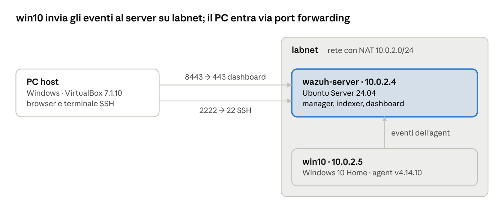
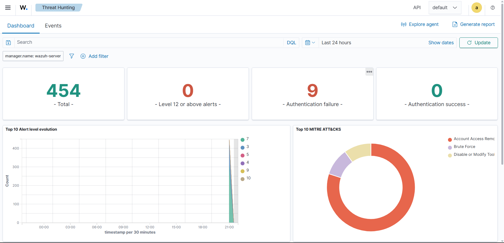
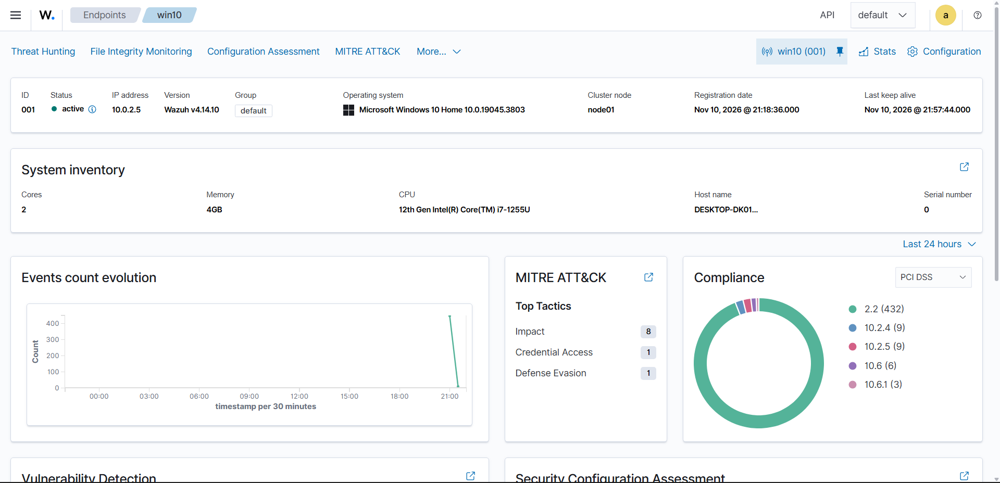
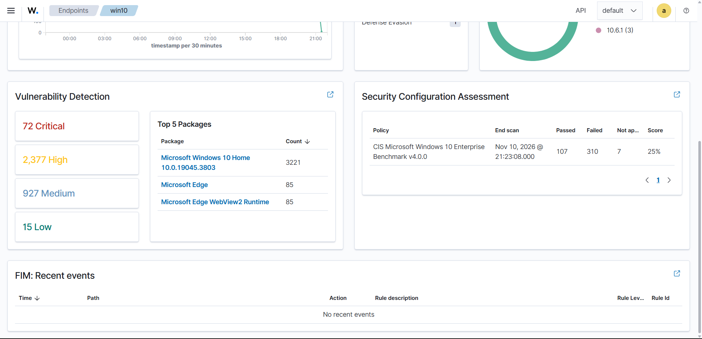

# Home lab SOC con Wazuh

SIEM Wazuh 4.14 installato in locale su VirtualBox che monitora un endpoint Windows 10. Nel primo scenario ho simulato una serie di login falliti, analizzato gli alert generati e chiuso un falso positivo correlando gli orari degli eventi.

**Competenze dimostrate:** deploy di un SIEM, configurazione di rete delle VM, analisi degli alert (Windows Event ID 4625), mappatura MITRE ATT&CK, triage di un falso positivo, vulnerability assessment e controllo della configurazione con il benchmark CIS.

---

## 1. Architettura

| Componente | Sistema | IP | Ruolo |
|---|---|---|---|
| wazuh-server | Ubuntu Server 24.04.5 LTS, ~6 GB RAM | 10.0.2.4 | Wazuh all-in-one: manager, indexer, dashboard |
| win10 (agent 001) | Windows 10 Home 10.0.19045.3803, 2 CPU, 4 GB RAM | 10.0.2.5 | Endpoint monitorato, Wazuh agent v4.14.10 |
| PC host | Windows, VirtualBox 7.1.10 | 127.0.0.1 | Accesso a dashboard e SSH tramite port forwarding |

Le due VM sono sulla rete **labnet**, una rete con NAT di VirtualBox (10.0.2.0/24, DHCP attivo): si vedono tra loro e hanno accesso a internet. Il PC host raggiunge il server solo tramite port forwarding.

| Regola | Host | Guest | Uso |
|---|---|---|---|
| dashboard | 127.0.0.1:8443 | 10.0.2.4:443 | Dashboard Wazuh dal browser |
| ssh | 127.0.0.1:2222 | 10.0.2.4:22 | Terminale SSH sul server |



## 2. Installazione

1. **Ubuntu Server 24.04** in VirtualBox, con OpenSSH abilitato e sistema aggiornato.
2. **Wazuh all-in-one** con lo script ufficiale (circa 15 minuti):
   ```bash
   curl -sO https://packages.wazuh.com/4.14/wazuh-install.sh && sudo bash ./wazuh-install.sh -a
   ```
3. **Rete:** passaggio da NAT semplice a rete con NAT `labnet`. In NAT semplice ogni VM è isolata, quindi l'agent non avrebbe potuto raggiungere il server.
4. **Port forwarding** sulla rete labnet per dashboard e SSH.
5. **Agent Windows:** dal dashboard, *Deploy new agent* (package Windows MSI, server `10.0.2.4`, nome `win10`). Ho eseguito i comandi generati in PowerShell come amministratore, poi `NET START Wazuh`. L'agent si è registrato alle 21:18:36 ed è risultato **active**.

### Problemi incontrati

| Problema | Causa | Soluzione |
|---|---|---|
| VirtualBox: "regole di inoltro non valide" | IP host scritto `127.0.01` | Corretto in `127.0.0.1` |
| Connessione SSH chiusa | Usata la password `admin` del dashboard | Per SSH serve la password dell'utente Ubuntu |
| Ctrl+Alt+F2 non apre un secondo terminale | VirtualBox non inoltra la combinazione | Accesso via SSH dal PC host |
| VM Windows bloccata all'avvio | Avvio lento con il server già acceso | Spegnimento forzato e verifica delle risorse |

## 3. Scenario 1 – Tentativi di login falliti

**Obiettivo:** verificare che Wazuh rilevi una serie di accessi falliti e la classifichi correttamente.

**Esecuzione:** su win10, dal Prompt dei comandi, ho ripetuto più volte questo comando inserendo password errate:

```cmd
runas /user:utentefinto cmd
```

**Rilevamento:** il dashboard ha registrato **9 alert "Authentication failure"**, e nel grafico MITRE ATT&CK è comparsa la tecnica **Brute Force (T1110)**.



**Analisi di un alert** (Threat Hunting → Events, query `rule.groups:authentication_failed`):

| Campo | Valore | Significato |
|---|---|---|
| rule.description | Logon failure - Unknown user or bad password | Descrizione della regola |
| rule.id | 60122 | Regola Wazuh per i login Windows falliti |
| rule.level | 5 | Gravità su 15: un singolo errore può essere un utente distratto |
| data.win.system.eventID | 4625 | Evento Windows "accesso non riuscito" (Security log) |
| data.win.eventdata.targetUserName | utentefinto | Utente tentato: inesistente |
| rule.mitre.id | T1531 | Account Access Removal |


**Considerazioni**

- Il singolo alert ha livello 5. Il segnale rilevante è la **ripetizione in poco tempo**, che fa scattare una regola correlata di livello più alto, mappata su Brute Force (T1110).
- Un **nome utente inesistente** fa pensare a un attaccante che prova a indovinare gli username. Tanti errori su un utente reale indicherebbero invece un attacco alla sua password.
- **Valutazione critica della mappatura MITRE:** T1531 sul singolo login fallito mi sembra discutibile. T1531 descrive un attaccante che *blocca* l'accesso agli utenti legittimi; probabilmente Wazuh la associa perché molti tentativi falliti possono causare il blocco dell'account.
- **Contromisura:** un criterio di blocco dell'account dopo un numero limitato di tentativi.

## 4. Triage di un falso positivo – "Wazuh agent stopped"

Durante il lab è comparso un alert **"Wazuh agent stopped"**, mappato su **MITRE T1562.001 (Disable or Modify Tools)**. È un segnale da verificare sempre: prima di agire, un attaccante spesso disattiva gli strumenti di sicurezza.

L'alert non ha un Event ID di Windows, perché non arriva dal registro eventi: è un messaggio interno inviato dall'agent stesso.

**Correlazione degli orari**

| Ora | Evento | Fonte |
|---|---|---|
| 21:18:36 | Registrazione dell'agent win10 | Dashboard → Endpoints → Registration date |
| 21:19 | `NET START Wazuh`, avvio del servizio | PowerShell su win10 |
| 21:19 | Alert "Wazuh agent stopped" | Threat Hunting |

**Esito:** *benign true positive*. L'agent si è fermato davvero, ma durante la propria installazione, un'attività autorizzata eseguita da me. Nessuna azione richiesta.




## 5. Vulnerabilità e configurazione dell'endpoint

**Vulnerability Detection:** 72 critiche, 2.377 alte, 927 medie, 15 basse. Il pacchetto più colpito è il sistema operativo stesso, Windows 10 Home 10.0.19045.3803, una build di fine 2023 mai aggiornata. Windows 10 non riceve più aggiornamenti di sicurezza da ottobre 2025: in un'azienda sarebbe un rilievo da gestire (aggiornare o isolare il sistema); in questo lab è un target vulnerabile utile.

**Security Configuration Assessment:** benchmark *CIS Microsoft Windows 10 Enterprise v4.0.0*. Risultato: 107 controlli superati, 310 falliti, 7 non applicabili, **punteggio 25%**. È atteso per un'installazione Windows Home standard. Va notato che il benchmark applicato è quello dell'edizione Enterprise.



## 6. Cosa ho imparato

- Un singolo alert raramente basta: conta la **correlazione** tra eventi e orari.
- La mappatura MITRE automatica è un punto di partenza, non una verità: va **valutata**.
- Non tutti gli alert hanno la stessa fonte: eventi di Windows e messaggi interni dell'agent hanno campi diversi.
- Chiudere un alert significa **documentare il motivo** con prove verificabili.

## Prossimi passi

- Hardening CIS su win10 (blocco account, cronologia password, AutoPlay) e confronto del punteggio prima e dopo
- Scenario 2: attacco da Kali Linux con cattura del traffico in Wireshark
