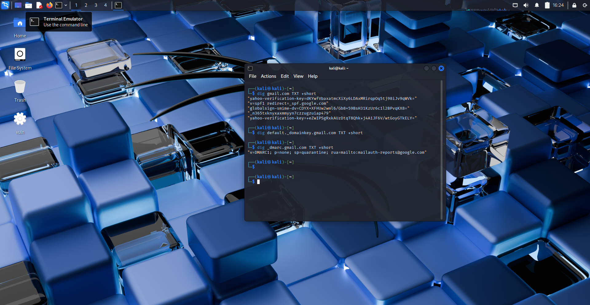
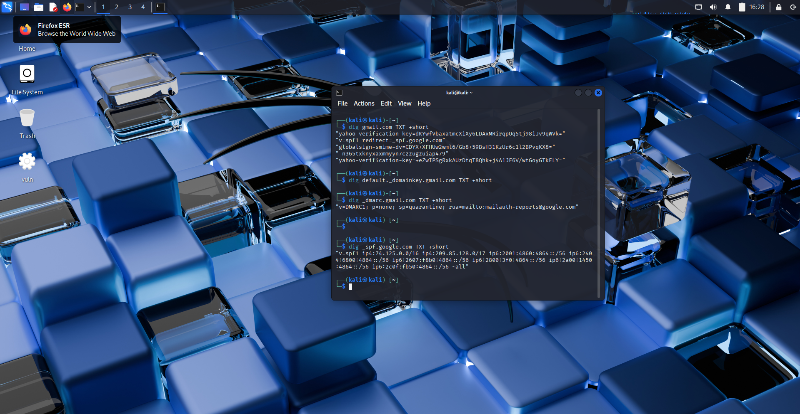
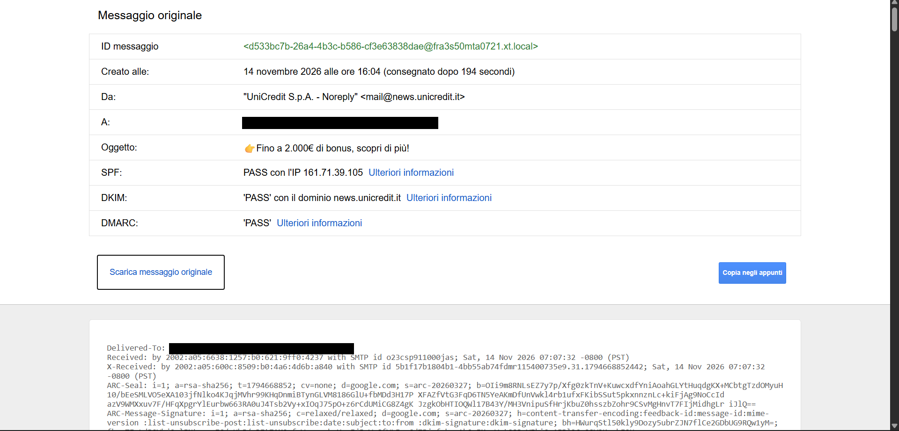
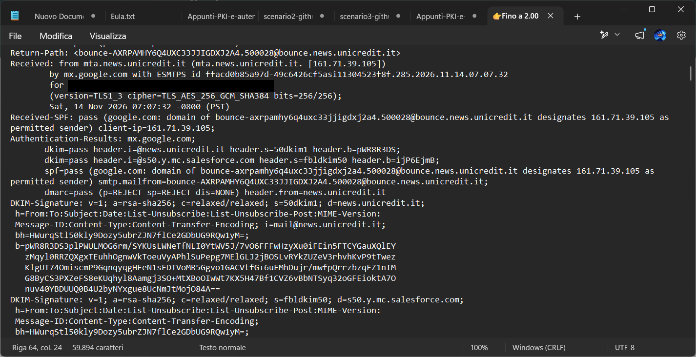
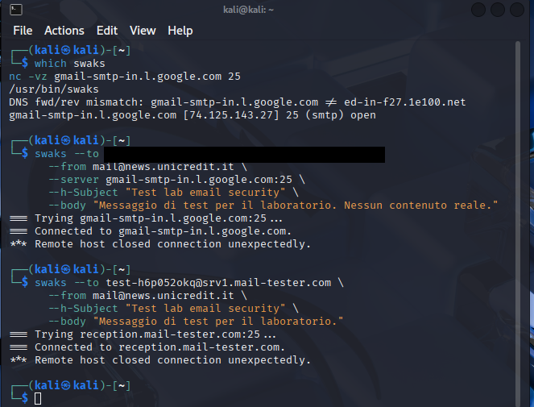

# Analisi di SPF, DKIM e DMARC su una mail reale

Lab di email security. Lettura dei record DNS di autenticazione e analisi degli header di un messaggio vero, con il collegamento al caso degli allarmi bomba via mail alle scuole italiane di novembre 2026.

Autore: Vito Dammiano
Data: 14 novembre 2026
Ambiente: Kali Linux (comandi `dig`) e Gmail su host Windows (lettura header)

## Obiettivo

Capire come si verifica che una mail venga davvero dal dominio che dichiara, e soprattutto capire il limite di questa verifica. Il filo che tiene insieme tutto il lab è una domanda sola: SPF, DKIM e DMARC certificano chi ha scritto il messaggio, o solo da dove è partito? La risposta spiega perché nel caso delle scuole la mail partiva da un account legittimo e passava ogni controllo.

## I record DNS di gmail.com

Il primo passo è leggere i record di autenticazione di un dominio noto. Si parte dal record SPF, che elenca i server autorizzati a spedire per quel dominio.

```
dig gmail.com TXT +short
dig _dmarc.gmail.com TXT +short
dig _spf.google.com TXT +short
```



La riga che conta nel primo output è `v=spf1 redirect=_spf.google.com`. Invece di elencare gli IP qui, Google rimanda a un altro record con `redirect`. È un modo per non duplicare liste lunghe su ogni dominio. Seguendo il rinvio compaiono gli indirizzi veri.



Qui gli IP ci sono tutti: `ip4:74.125.0.0/16`, `ip4:209.85.128.0/17` e i blocchi IPv6. La notazione CIDR indica intervalli: `/16` tiene fissi i primi 16 bit e lascia variare il resto, quindi copre oltre 65.000 indirizzi. Sono le reti dei server di posta in uscita di Google.

L'ultimo pezzo, `~all`, decide cosa fare per tutto ciò che non rientra negli intervalli sopra. Il simbolo davanti cambia il verdetto: `~all` è softfail, cioè "sospetta ma accettala e segnala"; `-all` è hardfail, "scartala"; `+all` autorizza chiunque e non va mai usato. Google usa softfail per non rompere la posta inoltrata in modo legittimo. Questo spiega una cosa importante: SPF da solo quasi mai blocca, al massimo segnala.

Il record DMARC di gmail.com è `v=DMARC1; p=none; sp=quarantine; rua=mailto:mailauth-reports@google.com`. La policy `p=none` vale per il dominio principale e significa "non fare niente di speciale se i controlli falliscono, limitati a segnalare". È la modalità osservazione. `sp=quarantine` è la policy per i sottodomini, più dura. `rua` è l'indirizzo dove arrivano i report aggregati. Che Google tenga `p=none` su gmail.com sorprende, ma ha senso: miliardi di utenti con configurazioni di invio diverse renderebbero `reject` troppo rischioso per la posta legittima.

## Gli header di una mail reale

Per vedere DKIM in azione serve un messaggio vero. Ho preso una newsletter di UniCredit ricevuta su Gmail e ho aperto "Mostra originale". Gmail mostra subito il riepilogo dei tre controlli.



Tutti e tre passano. Ora guardo gli header grezzi per capire perché.



### Il referto: Authentication-Results

La riga `Authentication-Results` è il verdetto che Gmail scrive dopo i controlli:

```
dkim=pass header.i=@news.unicredit.it header.s=50dkim1
dkim=pass header.i=@s50.y.mc.salesforce.com header.s=fbldkim50
spf=pass ... designates 161.71.39.105 as permitted sender
dmarc=pass (p=REJECT sp=REJECT) header.from=news.unicredit.it
```

Ci sono due firme DKIM, non una. SPF passa perché la mail arriva da `161.71.39.105`, un IP autorizzato. E qui compare già una differenza con gmail.com: la policy DMARC di `news.unicredit.it` è `p=REJECT`. Una banca rifiuta direttamente chi prova a spacciarsi per il suo dominio, non si limita a mandarlo in spam.

### L'origine vera: la catena Received

```
Received: from mta.news.unicredit.it (mta.news.unicredit.it. [161.71.39.105])
        by mx.google.com ...
```

Questa è la riga che permette di risalire al mittente reale. Si legge dal basso verso l'alto, perché ogni server che tocca la mail aggiunge un `Received` sopra il precedente. L'IP `161.71.39.105` è l'origine, e a differenza del campo `From` non è falsificabile: è l'indirizzo del socket TCP che ha consegnato il messaggio a Google.

### DKIM dall'header alla chiave

Nell'header della firma trovo selettore e dominio:

```
DKIM-Signature: ... s=50dkim1; d=news.unicredit.it; ... i=mail@news.unicredit.it;
```

Il campo `s` è il selettore, `d` è il dominio firmatario, `i` è l'identità per conto della quale si firma. Attenzione a non confondere `d` e `i`: l'allineamento DMARC si calcola sul dominio `d`, mentre nel suo riepilogo Gmail a volte mostra il valore `i`. Qui puntano entrambi a `news.unicredit.it`, quindi non cambia nulla, ma la distinzione è un classico punto di confusione.

Con selettore e dominio si compone il nome DNS dove vive la chiave pubblica, nello schema fisso `selettore._domainkey.dominio`:

```
dig 50dkim1._domainkey.news.unicredit.it TXT +short
```

Il risultato porta due informazioni. La prima riga è un CNAME verso `50dkim1._domainkey.s50.exacttarget.com`: il record DKIM di UniCredit non contiene la chiave, punta a ExactTarget, cioè Salesforce Marketing Cloud. La seconda è la chiave vera, `v=DKIM1; k=rsa; p=...`, spezzata in più stringhe perché un record TXT ha un limite di 255 caratteri per stringa e il resolver le riconcatena. È la chiave con cui Gmail ha verificato la firma presente nell'header.

### Perché due firme DKIM

La mail non è partita dai server di UniCredit ma da Salesforce, come confermano gli header `X-SFMC-Stack`, `Feedback-ID` e il CNAME verso ExactTarget. Eppure i controlli passano, perché UniCredit ha autorizzato Salesforce: `include` nel proprio SPF per gli IP, e CNAME `_domainkey` per far firmare Salesforce con il dominio di UniCredit. Le due firme hanno ruoli diversi. `d=news.unicredit.it` è quella che serve a UniCredit per l'allineamento. `d=s50.y.mc.salesforce.com` è quella di Salesforce, utile alla sua reputazione ma non allineata col mittente visibile.

## L'allineamento DMARC

DMARC non chiede solo "SPF o DKIM passano?", ma "passano per lo stesso dominio che l'utente vede nel `From`?". Questo è l'allineamento, ed è ciò che rende DMARC utile contro lo spoofing. In gioco ci sono tre domini scritti in campi diversi:

```
From:        mail@news.unicredit.it            (quello che vedi, header.from)
Return-Path: bounce-...@bounce.news.unicredit.it  (envelope sender, lo controlla SPF)
DKIM d=:     news.unicredit.it  e  s50.y.mc.salesforce.com  (chi firma)
```

DMARC passa se almeno uno tra SPF e DKIM, oltre a passare, è anche allineato con il dominio del `From`.

Lato SPF, il dominio validato è `bounce.news.unicredit.it`, mentre il `From` è `news.unicredit.it`. In modalità strict fallirebbe, perché non sono identici. In modalità relaxed invece si confronta il dominio registrato, `unicredit.it`, che è comune a entrambi: allineato.

Lato DKIM, la firma `d=news.unicredit.it` è identica al `From`, quindi allinea anche in strict. La firma di Salesforce, con dominio registrato `salesforce.com`, non allinea. Conta la prima, ed è esattamente per questo che UniCredit ha predisposto il CNAME verso ExactTarget: per far firmare Salesforce con il dominio della banca, non con il proprio. Senza quel CNAME ci sarebbe solo la firma `salesforce.com`, non allineata, e con `p=REJECT` la mail verrebbe rifiutata.

Da qui si capisce perché un attaccante non può fingersi la banca. Se scrive `From: mail@news.unicredit.it` e spedisce dal suo server, SPF controlla il suo Return-Path: o passa per il suo dominio, e allora non è allineato, oppure fallisce. Per allineare DKIM dovrebbe firmare con `d=news.unicredit.it`, ma gli serve la chiave privata di UniCredit, che non ha. Né SPF né DKIM allineati significa DMARC fallito, e con `p=REJECT` la mail viene rifiutata prima di arrivare.

## Un fail reale: un mittente legittimo via Amazon SES

Per vedere il rovescio del caso UniCredit ho analizzato una seconda mail vera, finita nello spam: un messaggio di servizio automatico da un'azienda IT reale (nome e dominio anonimizzati). Il mittente visibile è `career@azienda.example`, ma DMARC fallisce. La riga `Authentication-Results` spiega il perché:

```
dkim=pass header.i=@amazonses.com header.s=shh3...
spf=pass ... smtp.mailfrom=...@eu-west-1.amazonses.com
dmarc=fail (p=QUARANTINE sp=QUARANTINE dis=QUARANTINE) header.from=azienda.example
```

SPF passa, ma per il dominio dell'envelope `amazonses.com`, non per `azienda.example`. DKIM passa, ma la firma è di `amazonses.com`. Il `From` invece è `azienda.example`. DMARC confronta il dominio del `From` con quelli autenticati, non trova corrispondenza e fallisce. Il campo `dis=QUARANTINE` è la disposizione applicata davvero: la policy di `azienda.example` è `p=QUARANTINE`, quindi Gmail ha messo la mail in quarantena, cioè nello spam. Ecco perché era lì pur essendo autentica.

La differenza con UniCredit non è l'onestà del mittente, è la configurazione. Entrambi usano un servizio esterno per spedire, Salesforce per UniCredit e Amazon SES per l'altra azienda. UniCredit ha delegato bene, con l'`include` nel suo SPF e il CNAME DKIM a nome proprio, e DMARC passa. L'azienda ha lasciato che SES firmasse e autenticasse a nome di `amazonses.com`, senza allineare al proprio dominio, e DMARC fallisce.

| | UniCredit | Azienda (anonim.) |
| --- | --- | --- |
| From | mail@news.unicredit.it | career@azienda.example |
| Servizio di invio | Salesforce / ExactTarget | Amazon SES |
| SPF | pass, allineato a unicredit.it | pass, ma per amazonses.com |
| DKIM | pass, d=news.unicredit.it | pass, ma d=amazonses.com |
| DMARC | pass | fail |
| Policy ed esito | p=REJECT | p=QUARANTINE, finita in spam |
| Causa | delega configurata | delega non configurata |

La lezione per un analista è che un DMARC fail non vuol dire attacco. Qui è la configurazione sbagliata di un mittente legittimo. Gli indizi che lo confermano: SPF e DKIM in realtà passano, l'infrastruttura è un ESP noto come Amazon SES, e il contesto ha senso perché si tratta di una comunicazione di servizio legittima. Uno spoofing malevolo di solito non ha nemmeno queste caratteristiche, spesso SPF fallisce del tutto o manca una firma DKIM valida. Distinguere i due casi è il lavoro quotidiano di chi fa triage delle mail segnalate.

Nota sul metodo: generare da zero una mail che fallisse i controlli non è stato possibile, perché il provider di casa blocca la porta 25 in uscita e l'IP residenziale viene rifiutato dai server di posta per reputazione. Questo è già un insegnamento: la deliverability si decide prima dell'autenticazione, e un IP con cattiva reputazione non arriva nemmeno a farsi valutare. Per questo gli attaccanti preferiscono account e infrastrutture legittime. Il caso di fail è quindi una mail reale pescata dallo spam, più istruttiva di un test artificiale.

Il tentativo di invio con `swaks` verso due server diversi, Gmail e mail-tester, mostra lo stesso esito: la connessione TCP si apre, ma il server chiude subito senza nemmeno mandare il banner di benvenuto. È la firma di un blocco della porta 25 lato provider.



## Il collegamento al caso delle scuole italiane

L'11 novembre 2026 una mail di minacce ha raggiunto circa 6.000 scuole italiane, facendone evacuare centinaia. Secondo ANSA e la Central News Agency taiwanese partiva da un account compromesso della Dayeh University, a Taiwan, probabilmente quello di un ex studente. La società di threat intelligence Hudson Rock ha poi trovato quelle credenziali dentro log di infostealer datati oltre un anno prima: la password era stata rubata tempo addietro da un malware sul PC del proprietario, non durante l'attacco.

Il punto che lega il caso a questo lab è l'allineamento. L'attaccante non ha falsificato il dominio: ha fatto login su un account vero, usando l'infrastruttura Microsoft autorizzata per quel dominio. Quindi SPF e DKIM erano allineati per davvero, in modo legittimo. Non c'era nessun disallineamento da rilevare, e una policy DMARC a `reject` non avrebbe fermato niente. È il motivo per cui questi tre protocolli non bastano contro un account takeover: certificano che il canale è autorizzato, non che chi ha le chiavi in mano sia la persona giusta.

Due dettagli completano il quadro. Il mailbombing a migliaia di destinatari è stato automatico, via SMTP o API dell'account, con gli indirizzi delle scuole presi da fonti pubbliche; l'università se n'è accorta proprio dal volume anomalo di posta in uscita, e ha sospeso l'account. La firma "Mikhail Andropov, leader del Vilayat di Misoginistan" invece è solo testo nel corpo del messaggio: nessun protocollo la verifica, perché l'autenticazione controlla il canale, non le affermazioni scritte dentro. Era un depistaggio sovrapposto a un account tecnicamente legittimo.

## Comandi usati

```
dig gmail.com TXT +short
dig _dmarc.gmail.com TXT +short
dig _spf.google.com TXT +short
dig 50dkim1._domainkey.news.unicredit.it TXT +short
```

Lettura degli header da Gmail: apertura del messaggio, menu con i tre puntini, "Mostra originale", poi "Scarica originale" per il file completo.

## Difese pratiche

Contro lo spoofing diretto di un dominio, SPF, DKIM e DMARC con policy `reject` funzionano, come nel caso di `news.unicredit.it`. Contro un account takeover servono altre misure, perché i protocolli email non vedono il problema. Le due che contano di più sono l'autenticazione a più fattori sull'account, che blocca il login anche con la password rubata, e il monitoraggio delle credenziali compromesse su strumenti come Have I Been Pwned o Hudson Rock Cavalier, per sapere se un proprio indirizzo è finito in un leak e cambiare la password prima che venga usata.

## Domande di autoverifica

1. In `~all`, cosa cambia rispetto a `-all`, e perché Google sceglie il primo per gmail.com?
2. Leggendo la catena `Received`, qual è l'IP di origine reale della mail UniCredit, e perché non è falsificabile come il campo `From`?
3. Ci sono due firme DKIM: quale delle due fa passare l'allineamento DMARC, e perché l'altra no?
4. Nel caso delle scuole, perché una policy DMARC a `reject` non avrebbe fermato la mail partita dall'account della Dayeh University?
5. La seconda mail fallisce DMARC ma è legittima: quali elementi, negli header, ti fanno capire che è una misconfigurazione e non uno spoofing?

## Risposte

1. `~all` è softfail: ciò che non rientra negli IP autorizzati viene accettato ma segnalato come sospetto. `-all` è hardfail e lo scarta. Google sceglie softfail per gmail.com perché miliardi di utenti spediscono con configurazioni diverse, tra inoltri, client e mailing list, e un hardfail boccerebbe troppa posta legittima. Il filtro duro lo lascia a DMARC e all'antispam.

2. L'IP di origine reale è `161.71.39.105`, nella riga `Received: from mta.news.unicredit.it (... [161.71.39.105]) by mx.google.com`. Non è falsificabile come il campo `From` perché è l'indirizzo del socket TCP che ha davvero consegnato il messaggio a Google. Il `From` invece è testo libero, lo scrive il mittente come vuole.

3. Fa passare l'allineamento la firma con `d=news.unicredit.it`, perché il dominio coincide con quello del `From`. La firma con `d=s50.y.mc.salesforce.com` non allinea, perché il dominio registrato è `salesforce.com`, diverso da quello del mittente visibile. Serve alla reputazione di Salesforce, non all'allineamento di UniCredit.

4. Perché la mail partiva da un account vero, sull'infrastruttura Microsoft autorizzata per quel dominio. SPF e DKIM erano quindi allineati in modo legittimo. DMARC rifiuta i disallineamenti, cioè lo spoofing, ma qui non c'era nessun disallineamento da rilevare, perciò `reject` non sarebbe scattato. La difesa contro un caso così è la 2FA sull'account, non DMARC.

5. SPF e DKIM non falliscono, passano entrambi, solo per il dominio sbagliato (`amazonses.com` invece di `azienda.example`): è il segno di una delega a un ESP lasciata a metà, non di un falsario. A questo si aggiunge l'infrastruttura di invio nota e legittima, Amazon SES, e un contesto coerente, cioè una comunicazione di servizio legittima. Un vero spoofing di solito non supera nemmeno SPF o non porta una firma DKIM valida.
